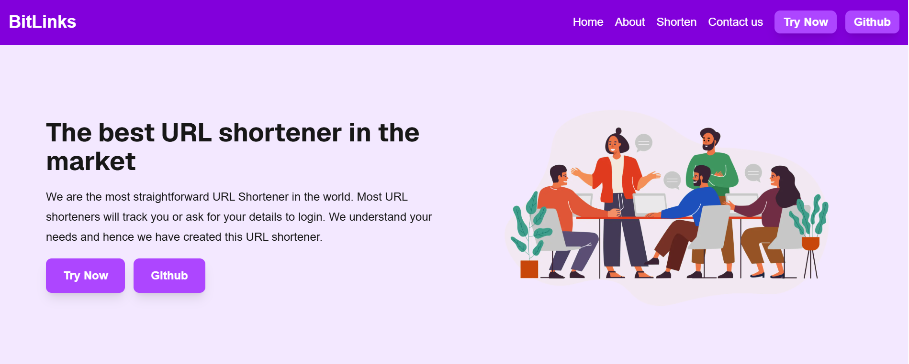

# BitLinks - Smart & Reliable URL Shortener 🔗

BitLinks is a full-stack web application designed to turn long, complex URLs into clean, shareable short links. Links are saved in a MongoDB database, so they keep working and redirect visitors instantly on any device.

## 🚀 Live Demo

[View the Live Project Here](https://bit-links-silk.vercel.app)

## 📸 Screenshots


 

## ✨ Key Features

- **Custom Short Links:** Create a personalized short URL for any website.
- **Persistent Storage:** Links are stored in MongoDB (via Mongoose), so they are still there after a restart.
- **Fast Redirection:** Server-side logic in Next.js looks up the short link and redirects the visitor right away.
- **Fully Responsive:** Works smoothly on mobile, tablet, and desktop.
- **Multi-Page UI:** Includes Home, Shorten, About, and Contact pages.

## 🛠️ Built With

- Next.js (React)
- MongoDB (Mongoose)
- Tailwind CSS

## 📦 Installation

1. Clone the repo:
```bash
git clone https://github.com/aiyu-dev/BitLinks.git
```

2. Go into the project folder:
```bash
cd BitLinks
```

3. Install dependencies:
```bash
npm install
```

4. Create a `.env` file in the root folder and add your MongoDB connection string:
```env
MONGODB_URI=your_mongodb_connection_string
```

5. Start the dev server:
```bash
npm run dev
```

6. Open the local URL shown in the terminal (usually `http://localhost:3000`).

## 📚 What I Learned

- Building a full-stack app with Next.js
- Connecting a Next.js app to MongoDB using Mongoose
- Handling dynamic routes and server-side redirects
- Managing environment variables safely
- Building responsive UI with Tailwind CSS

## 🎓 Credits

This project was built as part of my learning journey, following the tutorial by [CodeWithHarry](https://www.youtube.com/@CodeWithHarry). I wrote the code myself while following along to strengthen my backend and Next.js fundamentals, and extended it with About and Contact pages.

## 👩‍💻 Author

*Ayesha Shahzad*
Frontend Developer | Computer Science Student

- GitHub: [aiyu-dev](https://github.com/aiyu-dev)

⭐ If you like this project, consider giving it a star!